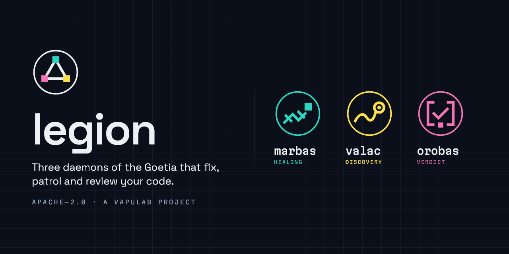
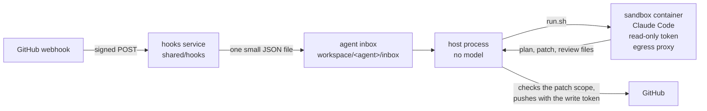

<div align="center">
  
  <h1>Legion</h1>
  <p><strong>Three autonomous engineering agents that fix bugs, find defects in production and review every pull request, while people keep the final say.</strong></p>
  <p>
    <a href="LICENSE">Apache-2.0</a> ·
    <a href="docs/HOST.md">Operate a host</a> ·
    <a href="docs/HOOKS.md">Webhooks</a> ·
    <a href="AGENTS.md">Contribute</a>
  </p>
</div>

## What Legion is

Legion is a set of three agents that work on one GitHub repository. Each agent is a small Python process on a Linux
VM that runs with no model. When it needs to think, it starts a fresh Docker container that runs
[Claude Code](https://docs.anthropic.com/en/docs/claude-code) headless, with read-only tokens and a network that
reaches only an allowlist. The container gives back files: a plan, a patch, a review. The host process checks them
and acts on GitHub and Slack with its own write token.

The agents never poll GitHub. Every GitHub event reaches them through one webhook service and a local inbox folder.
A person approves every plan, and by default a person merges every PR.

Legion is part of the [Vapulab](https://vapulab.com) family. Each Vapulab product is named after a daemon of the
Ars Goetia whose office matches what the software does.

## The three daemons

| | Daemon | Office in the Goetia | What it does in Legion |
| --- | --- | --- | --- |
|  | **Marbas** | A president who answers truly about hidden things and heals diseases. | Turns a bug thread in Slack into a reviewed PR. It posts a plan for an engineer to approve, fixes the bug inside that plan, repairs red CI, then watches the deploy and proves the fix in production telemetry. [Architecture](docs/MARBAS.md) |
|  | **Valac** | A president who tells where serpents are hidden and delivers them harmless. | Patrols the production logs on a schedule. It opens one GitHub issue per new defect, with the query and the counts as evidence, and can open the PR that fixes it. [Architecture](docs/VALAC.md) |
|  | **Orobas** | A prince who gives true answers of things past, present and to come, and never deceives. | Reviews every ready PR through a ladder of gates and lanes, each run by a Goetia persona. The host, never a model, decides the review state. [Architecture](docs/OROBAS.md) |

## How it works



1. GitHub sends each event to `https://<host>/webhooks/github`. Caddy passes it to the hooks service, which checks the
   HMAC signature and writes a file of six keys (`delivery`, `event`, `action`, `number`, `sha`, `received_at`) into
   the inbox of every agent that subscribes to the event. The payload itself is never stored.
2. The agent's host process reads its inbox, reads the facts it needs from the GitHub API, and decides what to do.
   No model runs on the host.
3. When the work needs a model, the host runs the agent's `sandbox/run.sh`. It starts the shared image
   `legion-sandbox:local` on an internal Docker network, with read-only GitHub and telemetry tokens and a Claude Code
   token, and a wall clock.
4. The container writes its result to a mounted folder: a `result.json`, a `fix.patch`, gate files. It never pushes.
5. The host checks the result. For a patch, it refuses any file the approved plan does not list and any guarded path,
   then applies the patch in a temporary clone, commits as the bot account and pushes. For a review, it computes the
   review state from the gate files and posts it.

## Safety model

Every model in Legion reads untrusted text: issue bodies, logs, diffs, CI output. The design assumes a model can be
talked into anything, and puts the limits outside it.

- **No agent polls GitHub.** Events arrive through the hooks service and a local inbox. Local timers (a heartbeat, a
  deploy timeout) are allowed; a loop that lists PRs is not.
- **The write token stays on the host.** It can push, and on a protected branch it may hold a bypass, so it never
  enters a container. A sandbox gets `github_sandbox_token`, which is read-only. Orobas's sandbox gets no GitHub
  token at all: the host fetches the code and writes the inputs.
- **An egress allowlist.** The sandbox network is `--internal`. The only way out is a tinyproxy container that lets
  through GitHub, Anthropic, Axiom, the package registries and the hosts in `LEGION_PROXY_HOSTS`.
- **A boot check.** Every entrypoint refuses to start when any environment variable matches `LEGION_BOOT_DENY`, a
  regex of production key names.
- **Managed settings.** Claude Code reads its permissions from `/etc/claude-code/managed-settings.json` in the image.
  `git push`, `git remote`, `git config`, `gh pr`, `gh api`, `curl`, `wget`, `ssh`, `env`, `printenv`, web fetch and
  web search are denied, and so is any edit of `.env*` files. A tool outside the allow list is denied, never prompted.
- **Guarded paths, refused twice.** `LEGION_GUARDED_PATHS` (by default `.github/`, `infra/`, `.claude/`, `.legion/`)
  are denied to Edit and Write inside the sandbox, and the host refuses any patch that touches them. Orobas never
  approves a PR that touches them.
- **The rules come from outside the PR.** The skills are mounted read-only from the Legion copy on the host, and
  Orobas reads the rulebook from the base branch. A PR cannot change the rules it is fixed or reviewed by.
- **Model text is cleaned.** The host escapes every `@` mention, drops AI attribution lines and HTML comment markers,
  and refuses a Valac finding that holds an email address.
- **A person decides.** An engineer approves every Marbas plan in Slack. By default a person merges every PR
  (`MARBAS_AUTO_MERGE=false`), Valac opens issues only (`VALAC_CAN_OPEN_PR=false`), and Orobas only comments
  (`OROBAS_CAN_APPROVE=false`, `OROBAS_CAN_BLOCK=false`).
- **Kill switches.** `MARBAS_ENABLED`, `VALAC_ENABLED` and `OROBAS_ENABLED` in `legion.env` stop new work; the
  `legion:skip` label keeps Orobas off one PR.

See [SECURITY.md](SECURITY.md) for the threat model and how to report a vulnerability.

## Requirements

- A Linux VM (Debian or Ubuntu for the setup script) with Docker and Python 3.11 or newer, reachable from GitHub over
  HTTPS.
- A GitHub bot account (a machine user) with two fine-grained personal access tokens on the repository: a write token
  for the host and a read-only token for the sandbox. See [docs/HOST.md](docs/HOST.md) for the permissions.
- A Claude Code subscription token, from `claude setup-token`.
- Optional: a Slack app in Socket Mode (Marbas), a Slack incoming webhook (Valac), [Axiom](https://axiom.co) for
  the production logs and the agents' run log, and [PostHog](https://posthog.com) for product telemetry.

Valac needs Axiom: it reads production logs there. Marbas needs Slack. Orobas needs only GitHub and Claude.

## Quick start

On the VM, as root:

```sh
# 1. The code
git clone https://github.com/darkanum/legion.git /opt/legion/repo
cd /opt/legion/repo

# 2. The settings: set at least LEGION_REPO, and LEGION_HOSTNAME for a fresh VM
cp legion.env.example /opt/legion/legion.env
$EDITOR /opt/legion/legion.env

# 3. The secrets: one file per secret, no trailing newline needed
mkdir -p /opt/legion/secrets && chmod 700 /opt/legion/secrets
( umask 077; cat > /opt/legion/secrets/github_host_token )     # paste, then Ctrl-D
( umask 077; cat > /opt/legion/secrets/github_sandbox_token )
( umask 077; cat > /opt/legion/secrets/claude_oauth_token )
# ... and the rest each agent lists in <agent>/secrets.txt

# 4. Everything: the VM (with LEGION_HOSTNAME), the sandbox, the hooks service, each agent
./setup.sh

# 5. The GitHub webhook: creates it, stores its secret, then start the hooks service
/opt/legion/venv/bin/python shared/hooks/host/webhook.py https://<LEGION_HOSTNAME>/webhooks/github
./setup.sh hooks
```

`setup.sh` is safe to run again. `./setup.sh <part>` runs one part: `host`, `sandbox`, `hooks`, `marbas`, `valac`
or `orobas`. The full walk-through is in [docs/HOST.md](docs/HOST.md).

## Configuration

Every setting is a line in `/opt/legion/legion.env`. [`legion.env.example`](legion.env.example) lists every key with
its default and a comment. Secrets never go there: they are files in `/opt/legion/secrets/`.

| Doc | What it covers |
| --- | --- |
| [docs/HOST.md](docs/HOST.md) | The host layout, every secret and its token permissions, setup, updates, logs, the run log, kill switches |
| [docs/HOOKS.md](docs/HOOKS.md) | The webhook service and the inbox contract |
| [docs/MARBAS.md](docs/MARBAS.md) | Marbas: Slack thread to PR to production proof |
| [docs/VALAC.md](docs/VALAC.md) | Valac: log patrol to issue to PR |
| [docs/OROBAS.md](docs/OROBAS.md) | Orobas: the review ladder and how the state is decided |

## Tests

The tests are plain `unittest` and need no install: no network, no Docker, no Slack SDK.

```sh
for folder in shared/lib shared/sandbox shared/hooks/host marbas/host valac/host orobas/host; do
  (cd "$folder" && python3 -m unittest)
done
```

One folder at a time: `cd orobas/host && python3 -m unittest`.

## Repository layout

```
setup.sh                # installs or updates everything on the host, in order
legion.env.example      # every setting, with its default
shared/                 # what two or more agents use; it names no agent
├── lib/                # host Python: paths, config, github, pull_request, inbox, axiom, jsonstore, keyvault
├── paths.sh            # every host path for the shell scripts
├── sandbox/            # the one image, the egress proxy, the managed settings, run-sandbox.sh
├── hooks/              # the GitHub webhook service and webhook.py
├── host/               # a fresh VM: Docker, Caddy, secrets from Azure Key Vault
└── skills/             # the skills two agents share, as /triage-bug
marbas/                 # Slack thread to PR
valac/                  # log patrol to issue
orobas/                 # PR review; orobas/rules/ holds the starter rulebook
└── each agent: subscriptions.json, secrets.txt, setup.sh, host/, sandbox/, skills/
docs/                   # the documentation
examples/rules/         # a repository's own rulebook for Orobas, as an example
brand/                  # the cover, the marks and the fonts
```

## License

Legion is licensed under the [Apache License 2.0](LICENSE).

---

<div align="center"><sub>A <a href="https://vapulab.com">Vapulab</a> project.</sub></div>
