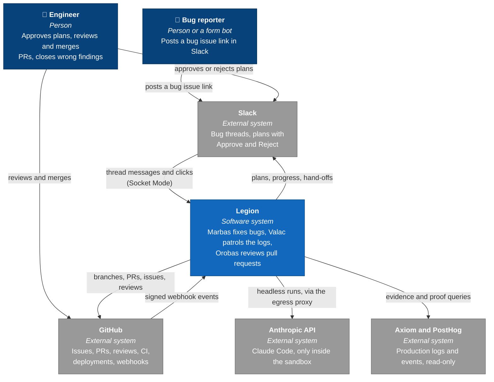
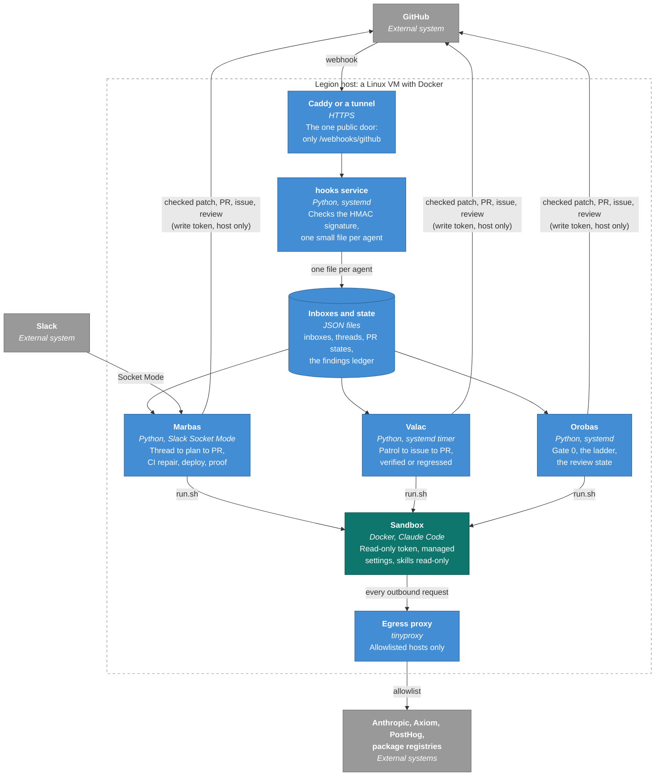
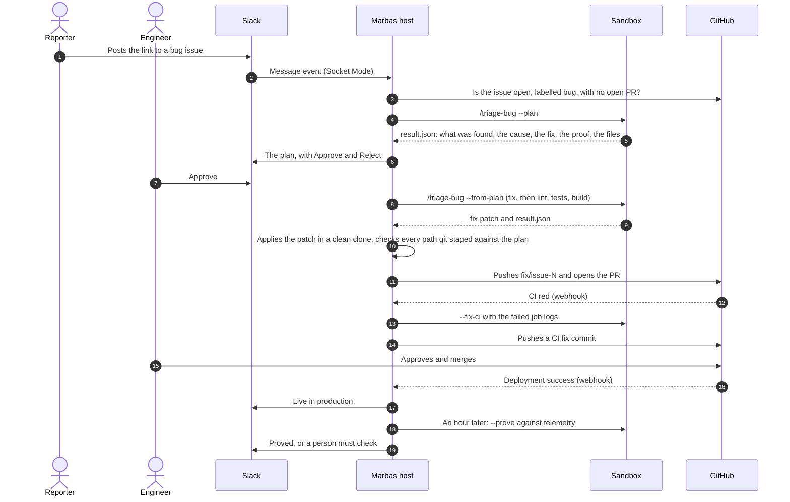
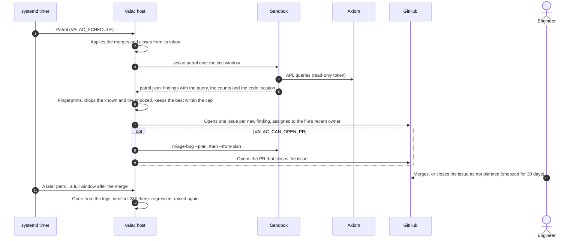
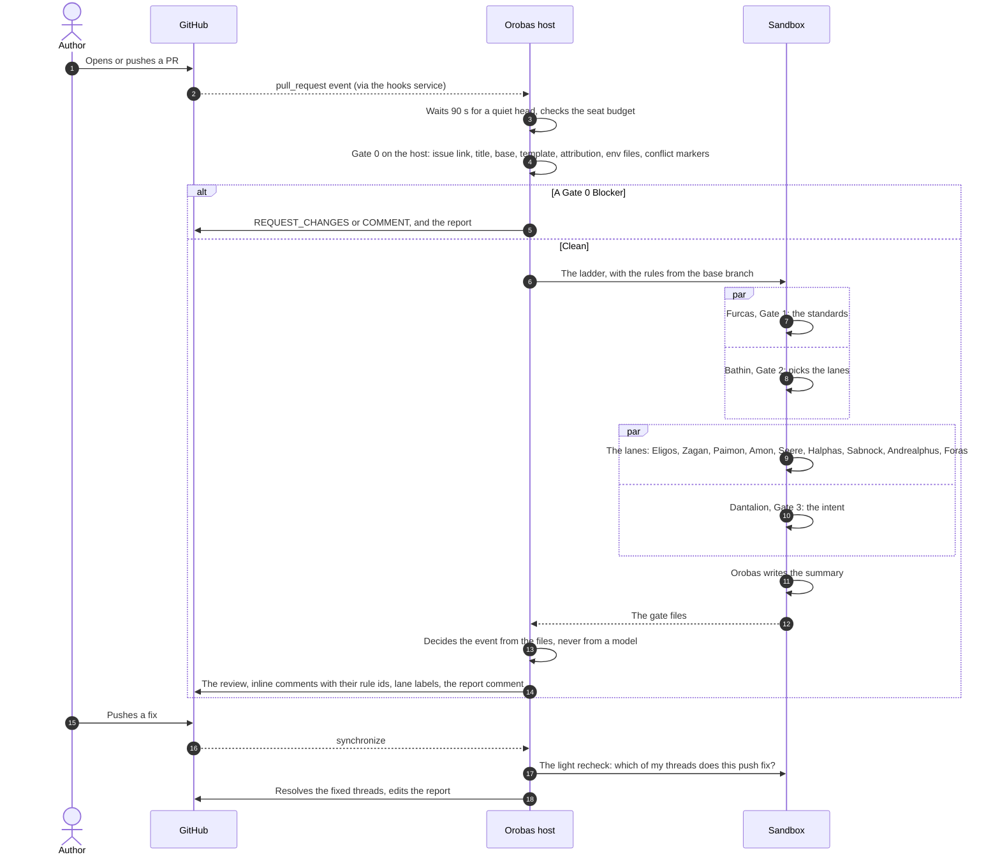
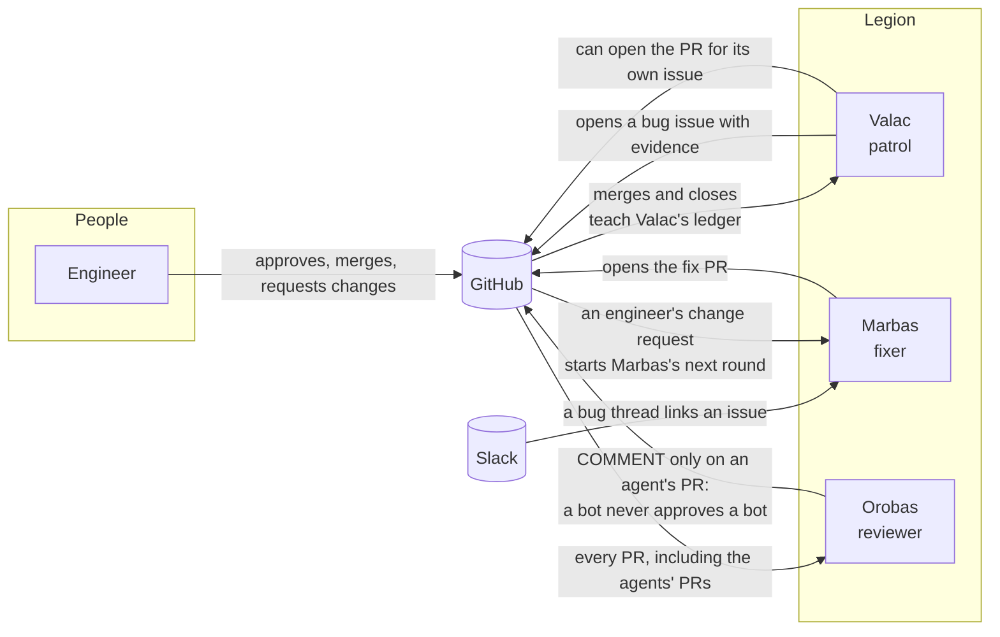

# Architecture

Legion is three agents that share one host, one webhook service and one sandbox image. This page draws them in the
[C4 model](https://c4model.com): the system in its context, the containers inside it, then one dynamic view per
daemon and one of how they meet. Each agent has its own page for the details: [MARBAS.md](MARBAS.md),
[VALAC.md](VALAC.md), [OROBAS.md](OROBAS.md), and [HOOKS.md](HOOKS.md) for the event path.

## 1. System context

Who and what Legion talks to. People stay in the loop at every decision that changes code.

## 2. Containers

What runs on the host. No model ever runs here: the host processes only move events, start sandboxes and check what
comes back. Every model step runs in a fresh container on a network with no route out except the proxy.

## 3. Marbas: a bug thread becomes a proven fix

## 4. Valac: a patrol finds a defect and follows it to the end

## 5. Orobas: a push becomes a review

## 6. How the daemons meet

The three never call each other. They meet on GitHub, through the same events every person sees.

- **Valac to Marbas.** A Valac issue is a bug issue with the query as evidence. With `VALAC_CAN_OPEN_PR` on, Valac
  runs the same `/triage-bug` skill Marbas uses and opens the PR itself; without it, a person can post the issue in a
  Marbas channel and Marbas takes it from there.
- **Marbas and Valac to Orobas.** Orobas reviews every PR an engineer can merge, the agents' PRs included. It never
  approves or blocks a PR written by a bot account (GitHub forbids an author to approve its own PR, and a bot must not
  vouch for a bot), so it only comments and a person decides.
- **People to all three.** An engineer's change request on a Marbas PR starts Marbas's next round
  (`MARBAS_ADDRESS_REVIEW`). A merge or a close teaches Valac's ledger. A dismissal in an Orobas thread is how a rule
  gets fixed.
