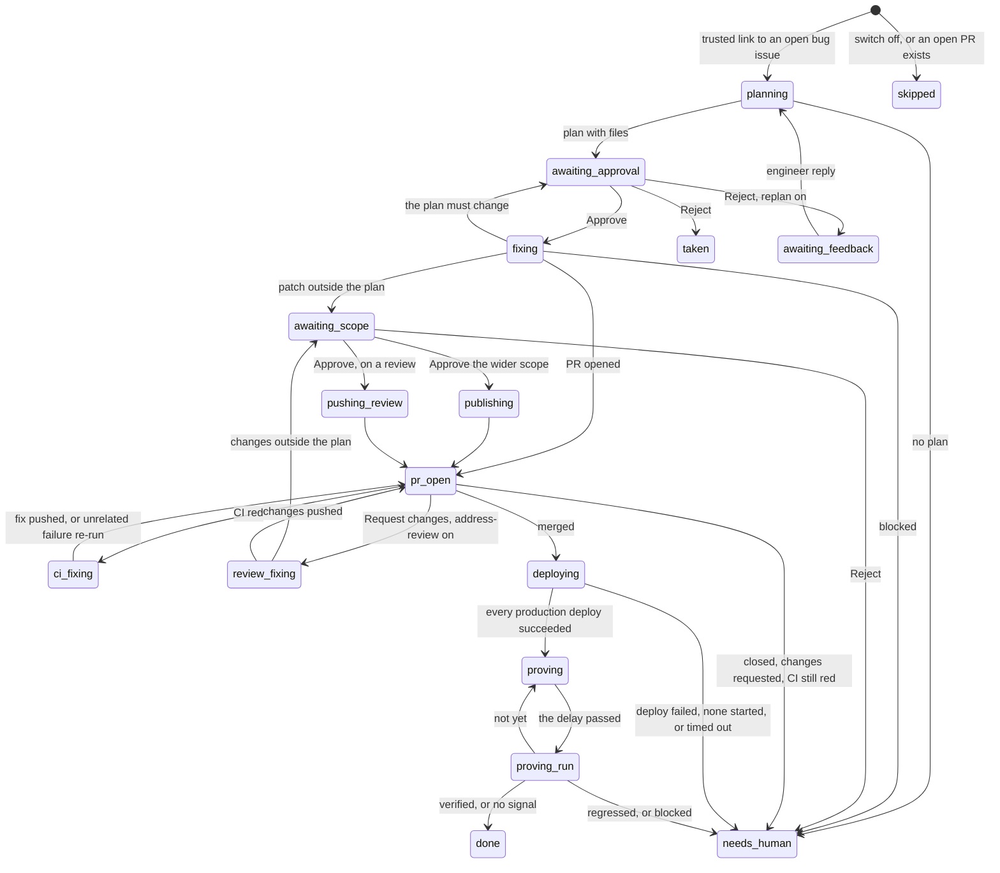

# Marbas

> Marbas, a great president of the Goetia, answers truly about hidden things and causes, and heals diseases.

Marbas turns a bug thread in Slack into a reviewed pull request. It posts a plan for an engineer to approve, fixes
the bug inside that plan, opens the PR, repairs red CI, applies review changes when allowed, then watches the deploy
and proves the fix in production telemetry.

| Part | File |
| --- | --- |
| Slack listener, job queue, timers | `marbas/host/listener.py` |
| GitHub side: open the PR, follow it to production | `marbas/host/pr.py` |
| Which thread a GitHub event moves | `marbas/host/events.py` |
| Thread state on disk | `marbas/host/state.py` |
| Engineer lessons | `marbas/host/memory.py` |
| The sandbox run | `marbas/sandbox/run.sh`, `marbas/sandbox/entrypoint.sh` |
| The skill | `/triage-bug` in `shared/skills/TRIAGE_BUG/` |
| systemd unit | `marbas/host/marbas-slack.service` |

## The trigger

Marbas watches the Slack channels in `MARBAS_CHANNELS` through Socket Mode. A thread starts when all of these hold:

- A message holds a link to an issue of `LEGION_REPO`: `https://github.com/<owner>/<repo>/issues/<n>`.
- The poster is trusted: a Slack user in `MARBAS_TRIGGER_USERS` (as the bot of a bug form), or an engineer when
  that list is empty, or an engineer in one of `MARBAS_TEST_CHANNELS`.
- With `MARBAS_TRIGGER_TEXT` set, the link is a reply in a thread whose parent holds that text and comes from the
  same poster. That fits a form or workflow bot that posts the report, opens the issue, and replies with its link.
  With it empty, a link posted at the top of the channel starts a thread on that message.
- The issue is open, has the `bug` label, and has no label that starts with `agent:`.
- No open PR already references the issue. Otherwise Marbas says which PR works on it and stops; posting the link
  again after that PR closes starts it.

An **engineer** is a member of `LEGION_TEAM` (or a collaborator with push access when it is empty) whose GitHub login
maps to a Slack id in `LEGION_SLACK_USER_MAP`, a JSON file read from the base branch. The list is cached for ten
minutes, and any error leaves nobody an engineer: it fails closed. Only an engineer can approve, reject, give
feedback or approve a wider scope.

Marbas reacts 👀 on the bug message when it takes it, and signs each message `:lion_face: *Marbas*`.

## The state machine

Each Slack thread has one `thread.json` in `workspace/marbas/threads/<channel>-<ts>/`, next to its plan, feedback, CI
and review files. Every stage change emits `marbas.thread.stage`.

| Stage | Meaning |
| --- | --- |
| `planning` | A `--plan` run is queued or running. |
| `awaiting_approval` | The plan is posted with Approve and Reject buttons. |
| `awaiting_feedback` | Rejected with `MARBAS_REPLAN_ON_REJECT=true`: the next engineer reply in the thread becomes feedback for a new round. |
| `taken` | Rejected: the engineer who rejected takes the bug, and the issue is assigned to them. |
| `fixing` | A `--from-plan` run is queued or running. |
| `awaiting_scope` | The patch touches files the plan did not list. An engineer approves the wider scope or rejects it. |
| `publishing` | The wider scope is approved; the same patch opens the PR, with no new run. |
| `pr_open` | The PR is open. GitHub events move it. |
| `ci_fixing` | CI is red; a `--fix-ci` run reads the failed job logs. At most two attempts. |
| `review_fixing` | An engineer requested changes and `MARBAS_ADDRESS_REVIEW=true`; an `--address-review` run applies them. At most three rounds. |
| `pushing_review` | The wider scope of a review fix is approved; the same patch goes to the PR branch. |
| `deploying` | Merged. Marbas watches the workflow runs and the GitHub deployments on the merge commit. |
| `proving` | Live. Marbas waits for users to reach the flow: one hour, then six, then six more. |
| `proving_run` | A `--prove` run reads production telemetry. |
| `done` | Proved in production, or the bug leaves no trail and a person must check. |
| `needs_human` | Marbas stopped and said why. *A human takes it from here*, and `LEGION_ONCALL_MENTION` is pinged. |
| `skipped`, `mirrored` | Not started (switch off or an open PR), or a stub for a shadow-mode mirror. |

### Plan

The plan has four sections, posted in the thread: *What I found*, *What was causing it*, *The fix*, *How I will prove
it*, then the number of files and the packages. Each button carries `<issue>:<round>`, so a stale button answers
"This plan is no longer open".

The plan run mounts `memory/marbas/` read-only at `/memory`: one Markdown note per past plan reject or PR change
request, with the engineer's words and the lesson. Only an engineer's words become a note; issue text never does, and
email addresses are masked. The sandbox never writes memory.

### Fix and scope

Approve starts the fix, which works inside the approved plan, then runs lint, tests and build. A fix that needs a
different plan comes back as `plan changed` and posts a new round.

The host then checks the patch. A file outside `plan.files` asks for a wider scope in the thread. A guarded path
(`LEGION_GUARDED_PATHS`) or an env file is never offered: the host refuses the patch. Then
`shared/lib/pull_request.py` applies the patch in a temporary clone at the run's base commit, commits as the bot
account with hooks off, pushes `fix/issue-<n>-<slug>`, and opens the PR against `LEGION_BASE_BRANCH` with
`Closes #<n>`. It requests `LEGION_PR_REVIEWERS` and `LEGION_PR_TEAM_REVIEWERS`, assigns the bot, and adds labels the
repository has (`docs`, `dependencies`, `<root>/<package>` for `LEGION_PACKAGE_ROOTS`).

The title and body come from the run (`prTitle`, `prBody`), with the issue form's prefix dropped from the title, every
mention escaped, attribution lines dropped, and a Marbas footer. The thread gets the score, the PR link, what was not
proved, and what a person must check.

### After the PR

The listener moves an open PR thread only on a GitHub event for that PR (or for its merge commit), on a deploy
timeout, or on a retry. On each, `pr.step()` reads the PR and decides:

1. Merged: `deploying`. Closed without a merge: `needs_human`.
2. CI red: `ci_fixing`, with the failed jobs and the failure lines of each log. A `--fix-ci` run either pushes a new
   commit (never a force push) or reports `ci unrelated`, and the host re-runs the failed jobs once. After two
   attempts, `needs_human`.
3. Changes requested: with `MARBAS_ADDRESS_REVIEW=true` and an engineer as reviewer, `review_fixing`; the run applies
   the review, the host pushes it, comments on the PR and asks the reviewer to look again. Otherwise `needs_human`
   and the issue moves to the reviewer. Either way the review becomes a memory note.
4. Approved by an engineer on the head commit, CI green, mergeable: with `MARBAS_AUTO_MERGE=true` the host merges;
   otherwise it says once that the PR is ready for a person to merge. A new commit voids the old approval.

While `deploying`, a failed workflow on the merge or a failed deployment in an environment that starts with
`LEGION_DEPLOY_ENVIRONMENT` is `needs_human`. Every deployment successful is live. No deployment after
`MARBAS_NO_DEPLOY_TIMEOUT_SECONDS`, or not done after `MARBAS_DEPLOY_TIMEOUT_SECONDS`, is `needs_human`. With
`LEGION_DEPLOY_ENVIRONMENT` empty, the merge is live once every workflow on it is green.

### Proof

One hour after the deploy, a `--prove <pr> --since <time>` run queries `legion-axiom` and `legion-posthog` for the
flow before and after the deploy:

| Outcome | Next |
| --- | --- |
| `verified` | `done`; the thread gets the query and the before and after. |
| `not yet` | Not enough use yet: look again in six hours, at most twice. |
| `no signal` | The bug leaves no trail in telemetry: `done`, and a person must check. |
| `regressed` | The bug is still in production: `needs_human`. |

## Sandbox modes

`marbas/sandbox/run.sh <issue> [mode]` runs one `/triage-bug` call in `legion-sandbox:local`, with
`MARBAS_WALL_SECONDS`, `MARBAS_MAX_TURNS`, `MARBAS_MEMORY` and `MARBAS_CPUS`. The inputs go in read-only at `/in`;
the run writes to `/out`. The clone is the base branch, or the PR branch for CI and review fixes.

| Mode | Flags | Input | Output |
| --- | --- | --- | --- |
| Plan | `--plan [--feedback <file>]` | the issue; past lessons in `/memory` | `result.json` with `plan` |
| Fix | `--from-plan <plan.json>` | the approved plan | `result.json`, `fix.patch`, `base.sha` |
| CI fix | `--fix-ci <ci.json> --plan-file <plan.json> --branch <b>` | the failed jobs and logs | `fix.patch`, or `ci unrelated` |
| Review fix | `--address-review <review.json> --plan-file <plan.json> --branch <b>` | the review and its inline comments | `fix.patch`, `reviewReply` |
| Prove | `--prove <pr> --since <time>` | the PR and the deploy time | `result.json` with `production` |
| Replay | `--at <sha>` | an older commit | any of the above, at that commit |

The sandbox gets `github_sandbox_token` (read-only), the Claude token, and the telemetry tokens the host has. The run
writes its notes under `tmp/marbas/<issue>/`, which is git-excluded, and the entrypoint turns every other change in
the tree into `fix.patch`. Only one Marbas run runs at a time; a second waits for the lock.

## Outputs

- Slack messages in the bug thread, or in the mirror thread in `MARBAS_SHADOW_CHANNEL` in shadow mode, where the
  real thread gets nothing.
- A PR on `fix/issue-<n>-<slug>`, and later commits on it for CI and review fixes.
- Issue assignments when a person takes the bug.
- Memory notes in `memory/marbas/`.
- Run log events: `marbas.thread.stage`, `marbas.run.finished` (mode, outcome, score, duration, turns, cost),
  `marbas.plan.decided`, `marbas.scope.decided`, `marbas.lesson.saved`, `marbas.pr.reviewers_failed`,
  `marbas.job.failed`, `marbas.event.failed`, `marbas.timer.failed`, `marbas.state.unreadable`, `marbas.heartbeat`.

## Settings

| Setting | Default | What it steers |
| --- | --- | --- |
| `MARBAS_CHANNELS` | required | The Slack channel ids Marbas watches |
| `MARBAS_TRIGGER_USERS` | empty | Who may start a thread; empty means any engineer |
| `MARBAS_TEST_CHANNELS` | empty | Where an engineer may start a thread by hand anyway |
| `MARBAS_TRIGGER_TEXT` | empty | Text the thread parent must hold |
| `MARBAS_SHADOW_CHANNEL` | empty | Run every bug in a mirror thread here |
| `MARBAS_ENABLED` | `true` | The kill switch for new threads |
| `MARBAS_AUTO_MERGE` | `false` | Merge after an engineer's approval and green CI |
| `MARBAS_REPLAN_ON_REJECT` | `false` | A Reject asks what to change instead of handing off |
| `MARBAS_ADDRESS_REVIEW` | `false` | Apply an engineer's requested changes, up to three rounds |
| `MARBAS_DEPLOY_TIMEOUT_SECONDS` | `5400` | How long a deploy may take |
| `MARBAS_NO_DEPLOY_TIMEOUT_SECONDS` | `1200` | How long to wait for a deploy to start |
| `MARBAS_WALL_SECONDS`, `MARBAS_MAX_TURNS` | `2700`, `200` | Limits of one run |
| `MARBAS_MEMORY`, `MARBAS_CPUS` | `6g`, `3` | Container limits |
| `LEGION_ONCALL_MENTION` | empty | Who a hand-off pings |
| `LEGION_SLACK_USER_MAP` | `.github/slack-user-map.json` | GitHub login to Slack id |
| `LEGION_DEPLOY_ENVIRONMENT` | `production` | Which deployments count as production |
| `LEGION_ISSUE_TITLE_PREFIX` | `[bug] ` | The prefix the PR title drops |

## Failure handling

- **A run blocks.** The run writes `outcome: blocked` with a reason, or the host writes it when the run hits its wall
  clock or leaves no result. The thread goes to `needs_human` and says why.
- **A job crashes on the host.** `marbas.job.failed`, `needs_human`, and the thread is told.
- **A GitHub step fails.** The thread says once per cause that it cannot check the PR, and the step retries after
  five minutes or on the next event for the PR. There is no poll.
- **A restart.** At boot the listener removes any orphaned `marbas-run-<issue>` container and queues the lost work
  again: a plan or a fix runs again (neither writes to GitHub before the host opens the PR), a CI or review fix runs
  again, a publish or push goes on, and a proof is tried again at once. The thread is told.
- **An event fails.** The inbox file is gone, so the whole event goes to `marbas.event.failed` for a replay.
- **Untrusted text.** Every model string posted to Slack is escaped (`&`, `<`, `>`, and a word joiner after each
  `@`), so only the host's own `LEGION_ONCALL_MENTION` can ping anyone. Every string posted to GitHub has its
  mentions broken and its attribution lines dropped.
