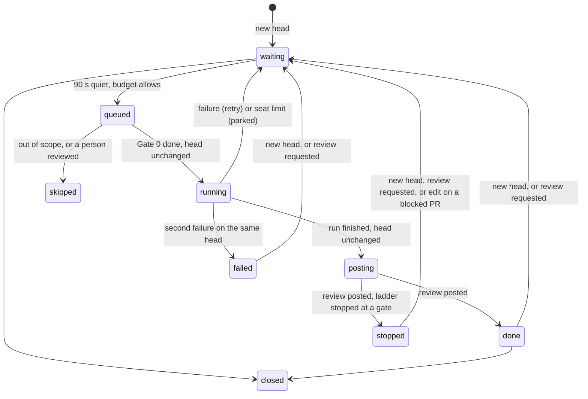

# Orobas

> Orobas, a great prince of the Goetia, gives true answers of things past, present and to come, and never deceives.

Orobas reviews every ready pull request through a ladder of gates and lanes. Each stage is run by a daemon of the
Goetia whose office fits the work. Models find and explain; the host decides. The review state (APPROVE,
REQUEST_CHANGES or COMMENT) is computed by code from the gate files, never picked by a model.

| Part | File |
| --- | --- |
| Events, state, worker, posting | `orobas/host/reviewer.py` |
| The ladder table: personas, skills, models, limits, lanes, labels | `orobas/host/stages.py` |
| Gate 0, the rules a host decides alone | `orobas/host/gate0.py` |
| The review state and the text cleaning | `orobas/host/verdict.py` |
| The report comment | `orobas/host/report.py` |
| The seat share and the daily cap | `orobas/host/budget.py` |
| The bare clone and the run inputs | `orobas/host/context.py` |
| The sandbox run | `orobas/sandbox/run.sh`, `orobas/sandbox/review.sh` |
| The skills | `orobas/skills/OROBAS_STANDARDS/`, `OROBAS_TRIAGE/`, `OROBAS_INTENT/`, `OROBAS_LANE/`, `OROBAS_REPORT/`, `OROBAS_RECHECK/` |
| The starter rulebook | `orobas/rules/` |
| systemd unit | `orobas/host/orobas.service` |

## The trigger

Orobas reads its inbox every two seconds. It takes `pull_request` (opened, reopened, ready_for_review, synchronize,
review_requested, edited, labeled, unlabeled, closed) and `check_suite` completed.

- **A new head** (a push, or the first event of a PR) resets the PR to `waiting`. A review that runs on an older head
  is killed.
- **A head waits 90 seconds** with no new push before it is queued, so a burst of pushes gets one review.
- **A review request** from a person runs the full ladder again, even on a head already reviewed.
- **An edit or a label change** re-runs only a PR the bot blocked, since a body or label fix can clear a Blocker with
  no push.
- **A finished check suite** on a reviewed head decides the state again from the saved files, with no model: a green
  CI can turn a COMMENT into an APPROVE.
- **A close** marks the PR closed and kills its run.

A PR is reviewed only when it is open, not a draft, from a branch of the same repository (no forks), without the
`legion:skip` label, and written by an engineer (`LEGION_TEAM`, or a collaborator with push access). A PR that a
person already reviewed is skipped, unless a person requests a review from the bot.

## The state machine

One JSON file per PR in `workspace/orobas/prs/<n>.json`. Every stage change emits `orobas.stage`.

| Stage | Meaning |
| --- | --- |
| `waiting` | The head waits for 90 quiet seconds, a budget, or a retry. |
| `queued` | In the worker queue. A full review took one of today's places. |
| `running` | Gate 0 ran; the sandbox runs the ladder. |
| `posting` | The host decides the state and posts. |
| `done` | Reviewed. The next push gets the light recheck. |
| `stopped` | Reviewed, but the ladder stopped at Gate 0 or Gate 1. The next push gets the full ladder. |
| `failed` | Two failures on this head. It waits for a new push or a review request. |
| `skipped` | Out of scope, or a person already reviewed it. |
| `closed` | The PR closed. |

Every write that belongs to a head checks that the state still holds that head, so a push during a run always wins.

## The ladder

| Step | Daemon | Runs on | Model | Limits | What it does |
| --- | --- | --- | --- | --- | --- |
| Gate 0, Rules | 🤖 Host | host, no model | none | about a second | Checks `STD-01` to `STD-07` from the PR data and the diff text. A Blocker stops the review before any container starts. |
| Gate 1, Standards | 📏 Furcas | sandbox | deep | 40 turns, 300 s | Reads `STANDARDS.md` with judgement. A Blocker stops the rest of the ladder. |
| Gate 2, Triage | 🧭 Bathin | sandbox, with Gate 1 | fast | 8 turns, 120 s | Picks the lanes the change needs, by `TRIAGE.md`. |
| Lanes | see below | sandbox, in parallel | deep | 30 turns, 300 s each | Each lane reviews one kind of risk, by its `LANE_<LANE>.md`. At most `OROBAS_MAX_LANES`. |
| Gate 3, Intent | 🎭 Dantalion | sandbox, with the lanes | deep | 45 turns, 360 s | Judges whether the change does what its issue asks, by `INTENT.md`. |
| Report | 🐴 Orobas | sandbox, last | fast | 6 turns, 120 s | Writes the summary paragraph and the review body. |
| Recheck | 🐴 Orobas | sandbox | fast | 15 turns, 240 s | After the first full review: reads the diff since the last checked head and says which of the bot's open threads it fixes. |

"Deep" is `LEGION_MODEL`, "fast" is `LEGION_FAST_MODEL`. The whole run has a 720-second wall clock. Gate 1 and Gate 2
start together; when Gate 2 ends, the lanes and Gate 3 start together; a Gate 1 Blocker kills whatever still runs.

| Lane | Daemon | Reviews |
| --- | --- | --- |
| `security` | 🛡️ Eligos | Who can reach what, and what leaves |
| `data` | 🗄️ Zagan | Schemas, migrations, queries and indexes |
| `ai` | 🧠 Paimon | Model calls, prompts, evals and cost |
| `product` | 🎯 Amon | What was asked, and what the user gets |
| `performance` | ⚡ Seere | Hot paths, memory, reads and queues |
| `devops` | 🏗️ Halphas | CI, images, health, logs and monitors |
| `infra` | 🏰 Sabnock | Infrastructure as code, names and cost |
| `design` | 📐 Andrealphus | The build matches the design and the design system |
| `tests` | 🔬 Foras | The behaviour is proven |

The lanes are ordered by risk: when Bathin picks more than `OROBAS_MAX_LANES`, the first in this order run. The host
keeps only lanes from this list, and labels the PR `review:<lane>` for each lane that ran.

### Why each daemon

| Daemon | Office in the Goetia | Why it fits |
| --- | --- | --- |
| Furcas | Teaches philosophy, logic and rhetoric | The standards are rules read with judgement and argued in plain words. |
| Bathin | Carries people swiftly from one country to another | Triage sends the PR to the lanes it belongs in. |
| Eligos | Discovers hidden things, and knows of wars and soldiers | Security finds what an attacker would find first. |
| Zagan | Turns one substance into another: wine into water, metal into coin | Data work transforms schemas and records. |
| Paimon | Teaches every art and science, and the secrets of the mind | The AI lane reads the prompts and the model calls. |
| Amon | Tells of things past and to come, and reconciles friends | The product lane holds the change to what was asked and what users will get. |
| Seere | Goes to any place on earth in an instant | Performance is about speed. |
| Halphas | Builds towers, stocks them with weapons, sends warriors where they must go | DevOps builds the pipelines and ships the images. |
| Sabnock | Builds high towers and fortifies castles | Infrastructure as code builds and hardens the ground everything stands on. |
| Andrealphus | Teaches geometry and all that belongs to measurement | Design review measures the build against the design. |
| Foras | Teaches logic and ethics, and finds what was lost | Tests prove the behaviour and find the case nobody covered. |
| Dantalion | Knows the thoughts of every person, and can change them | Intent reads what the author meant, and checks the change does it. |
| Orobas | Answers truly of things past, present and to come, and never deceives | The report says what the review found, and no more. |

## Gate 0

Gate 0 is plain code in `gate0.py`. It stays narrow on purpose: a false Blocker costs more than a miss, because
Gate 1 reads the same rules with judgement.

| Rule | Check | Severity |
| --- | --- | --- |
| `STD-01` | The PR closes an issue GitHub registers, or has the `no-issue` label (`OROBAS_REQUIRE_ISSUE`) | blocker |
| `STD-02` | The title is `type: message` (or `type(scope): message` with `OROBAS_TITLE_NEEDS_SCOPE`), the type is in `OROBAS_BRANCH_TYPES` and matches the branch prefix | important; a branch with no known prefix is a note |
| `STD-03` | The base is `LEGION_BASE_BRANCH`, one of `OROBAS_EXTRA_BASES`, or the open head the body says it is `Stacked on #N`; no conflicts; no commit merges a branch in `OROBAS_FORBIDDEN_MERGES` | blocker |
| `STD-04` | No prompt or empty numbered step left from `.github/PULL_REQUEST_TEMPLATE.md`, read at the base commit | important |
| `STD-05` | No AI attribution line in the body or a commit (`OROBAS_FORBID_ATTRIBUTION`) | important |
| `STD-06` | No added `.env`, `.env.*` or `*.env` file, except `.example`, `.sample`, `.template` | blocker |
| `STD-07` | No added merge conflict marker | blocker |

## The run

Before a run, the host prepares everything the models need, so they need fewer turns and the sandbox never calls
GitHub:

- `pr.json` (title, body, base, head, author, labels, reviewers and reviews, linked issues with their text, commits,
  CI state, files), `diff.patch`, `threads.json` (the review threads), `gate0.json`, `stages.json` (the ladder table
  from `stages.py`) and `mode`;
- `files/`, the full text of every touched file at the head;
- `agents.md`, every `LEGION_GUIDE_FILES` file from the root down to each touched folder;
- `consumers.json`, the files that use each new exported name.

The host keeps a bare clone in `workspace/orobas/repo.git` and fetches only the base branch and the PR head. The
container mounts it read-only. Inside, `review.sh` checks out the head at `~/repo` and the base branch at `~/rules`,
and reads the rulebook from `~/rules/LEGION_RULES_DIR` when that folder holds a `STANDARDS.md`, or from the starter
rulebook in `orobas/rules/` otherwise. Neither the rules, the skills nor the stages come from the PR.

Each stage is one `claude -p` call that writes one file under `tmp/pr-review/`, checked against a schema before it is
copied to `/out`. Claude runs from `~/work`, not the clone, so the head's `CLAUDE.md` and project settings never
load. Subagents are disallowed. Before the report stage the script takes a digest of every gate file, and fails the
run if any changed after its gate.

The sandbox gets the Claude token and nothing else: no GitHub token, no telemetry token. Up to five `claude`
processes run at once, in `OROBAS_MEMORY` and `OROBAS_CPUS`.

## How the host decides

`verdict.py` collects the findings of every source that finished (Gate 0, Gate 1, each lane, Gate 3, or the recheck),
keeps one comment per line (the most severe), drops a comment on a line that already has an open bot thread, and
counts the Blockers. A gate that says `fail` with no blocker line still counts as one. Then `decide()` takes the
first rule that applies:

| # | Condition | State |
| --- | --- | --- |
| 1 | The PR author is the bot account or another bot (as a Marbas or Valac PR) | COMMENT: a person must approve |
| 2 | An `OROBAS_ALWAYS_BLOCK` rule is a Blocker (default `STD-01`) | REQUEST_CHANGES |
| 3 | Blockers, and `OROBAS_CAN_BLOCK=false` | COMMENT: a person decides |
| 4 | Blockers | REQUEST_CHANGES |
| 5 | Earlier bot comments still open | COMMENT |
| 6 | A stage the ladder needed did not finish | COMMENT |
| 7 | CI red | COMMENT |
| 8 | CI still running | COMMENT; the next `check_suite` decides again |
| 9 | The PR touches a guarded path | COMMENT: the team must approve |
| 10 | The PR is stacked on another branch | COMMENT: approved only when its base is the trunk |
| 11 | `OROBAS_CAN_APPROVE=false` | COMMENT: asks the team to approve |
| 12 | Otherwise | APPROVE |

Inline comments go on right-side lines of the diff; a comment off the diff moves to the review body. At most 30
comments. Every model string goes through `clean()`: attribution lines dropped, em dashes replaced, HTML comment
markers removed, every `@` broken. The only live mention is the team, written by the host.

After posting, the host dismisses its own earlier REQUEST_CHANGES when no Blocker and no earlier thread is left, and
resolves the threads a gate marked fixed.

### The report

One comment per PR, edited in place on every run and found again by a hidden marker when its id is lost. The host
renders every fact: the ladder table (gate, daemon, result), the Blockers with links to their lines, the verdict and
its reason, and the cost line (tokens, equivalent USD, share of the seat window). The report stage contributes only
the summary paragraph. A recheck replaces its own section of the report and posts a new review only for a new
comment or a new state.

## Budget

All three agents share one Claude seat, so Orobas keeps to a share of it:

- **Window cap.** Orobas may spend `OROBAS_SEAT_WINDOW_USD × OROBAS_SEAT_SHARE` of equivalent cost in any rolling
  five hours (default 160 × 0.35 = 56 USD). The window size is a measure, not a value the seat reports.
- **Seat limit.** A stage that the seat answers with a 429 parks the PR until the reset time the message names (one
  hour when it names none). It is not a failure.
- **Daily cap.** At most `OROBAS_DAILY_FULL_REVIEWS` full reviews a UTC day, oldest PR first. A recheck does not
  count, and a counted review that did not run gives its place back.

A hold emits `orobas.budget.reached` once per reason; the heads keep waiting.

## Outputs

- A pull request review (APPROVE, REQUEST_CHANGES or COMMENT) with inline comments, on the reviewed head.
- The report comment.
- `review:<lane>` labels; Orobas creates and fixes its labels (`legion:skip` and the lanes) at start.
- Run log events: `orobas.stage`, `orobas.review.posted` (state, blockers, CI, comments, lanes, latency, tokens,
  cost), `orobas.gate.finished` (one per stage: persona, model, status, findings, duration, cost),
  `orobas.review.skipped`, `orobas.review.superseded`, `orobas.review.parked`, `orobas.review.failed`,
  `orobas.recheck.failed`, `orobas.budget.reached`, `orobas.labels.failed`, `orobas.state.unreadable`,
  `orobas.heartbeat`.

## Settings

| Setting | Default | What it steers |
| --- | --- | --- |
| `OROBAS_ENABLED` | `true` | The kill switch for new reviews |
| `OROBAS_CAN_APPROVE` | `false` | COMMENT where it would APPROVE |
| `OROBAS_CAN_BLOCK` | `false` | COMMENT where it would REQUEST_CHANGES |
| `OROBAS_ALWAYS_BLOCK` | `STD-01` | Rules that block even with `OROBAS_CAN_BLOCK=false` |
| `OROBAS_REQUIRE_ISSUE` | `true` | `STD-01` on or off |
| `OROBAS_BRANCH_TYPES` | `feat,fix,chore,docs,refactor,test,perf,ci,build` | `STD-02` types and branch prefixes |
| `OROBAS_TITLE_NEEDS_SCOPE` | `false` | `STD-02` requires `(scope)` |
| `OROBAS_EXTRA_BASES`, `OROBAS_FORBIDDEN_MERGES` | empty | `STD-03` |
| `OROBAS_FORBID_ATTRIBUTION` | `true` | `STD-05` on or off |
| `OROBAS_MAX_LANES` | `4` | Lanes per review |
| `OROBAS_DAILY_FULL_REVIEWS` | `50` | Full reviews a UTC day |
| `OROBAS_SEAT_WINDOW_USD`, `OROBAS_SEAT_SHARE` | `160`, `0.35` | The window cap |
| `OROBAS_MEMORY`, `OROBAS_CPUS` | `3g`, `2` | Container limits |
| `LEGION_RULES_DIR` | `.legion/rules` | Where the repository keeps its own rulebook |
| `LEGION_GUIDE_FILES` | `AGENTS.md,CLAUDE.md` | The guide files sent to every stage |
| `LEGION_MODEL`, `LEGION_FAST_MODEL` | | The deep and fast models |

The turns, timeouts and efforts of each stage live in `stages.py` and change by PR.

## Failure handling

- **A failed review** (no status, a broken Gate 1 or Gate 3, a non-zero exit) puts the head back to `waiting` for one
  retry; the second failure on the same head is `failed`. A Claude API fault warns on the first try and pages on the
  last.
- **A superseded review.** A push or a close kills the container. The run's missing files are not a failure:
  `orobas.review.superseded`, and the new head keeps its own state.
- **A partial ladder.** A lane or Gate 2 that did not finish never stops the review; the decision cannot be APPROVE
  and the report says which stage did not finish.
- **A GitHub refusal.** A 422 on an inline line moves the comments to the body. A 5xx lists the reviews first, so a
  review is never posted twice. A failure after the review is out is logged and never counted as a failed review.
- **A restart.** Every head in `queued`, `running` or `posting` goes back to `waiting`, and its container is removed.
  A review only reads, so a repeat is safe.
- **A recheck after CI** that fails keeps the stage; the next `check_suite` tries again.
- **Dry run.** `reviewer.py --dry-run <pr>` prints the state, the comments and the report with no post and no state
  change; `--from-run <run-dir>` replays a saved run with no model.
