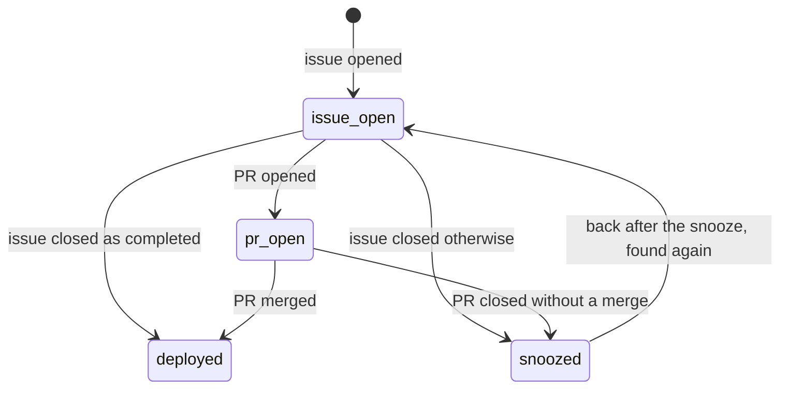

# Valac

> Valac, a great president of the Goetia, rides a two-headed dragon, tells where serpents are hidden, and delivers
> them harmless.

Valac patrols the production logs on a schedule. It finds the defects hidden in them, opens one GitHub issue per new
defect with the query and the counts as evidence, and, when allowed, opens the PR that fixes it. It never opens a
second issue for a defect it already raised, and it never floods the team.

| Part | File |
| --- | --- |
| The patrol, issue and PR flow | `valac/host/valac.py` |
| The finding ledger | `valac/host/ledger.py` |
| Issue title and body | `valac/host/issue_text.py` |
| Slack posts | `valac/host/notify.py` |
| The sandbox run | `valac/sandbox/run.sh`, `valac/sandbox/entrypoint.sh` |
| The skills | `/valac-patrol` in `valac/skills/`; `/triage-bug` in `shared/skills/TRIAGE_BUG/` |
| systemd units | `valac/host/valac-patrol.service`, `valac/host/valac-patrol.timer` |

## The trigger

A systemd timer, `valac-patrol.timer`, starts the patrol on `VALAC_SCHEDULE` (by default `Mon..Fri *-*-* 07:00:00
UTC`). `Persistent=true` runs a missed patrol at boot. The patrol is a one-shot process: there is no long-lived
Valac service.

Valac also subscribes to `pull_request` closed and `issues` closed. Those events wait in its inbox and are applied
at the start of the next patrol.

With `VALAC_ENABLED=false` (the default), the patrol starts and exits at once. Turn it on once
`LEGION_LOG_DATASETS` is set and `axiom_token` is stored.

## One patrol

1. **Apply the inbox.** For each closed PR or issue that belongs to a finding:
   - a merged Valac PR, or an issue closed as `completed` with no Valac PR, moves the finding to `deployed`;
   - any other close (a PR closed without a merge, an issue closed as `not_planned`) is a reject: the finding sleeps
     for `VALAC_SNOOZE_DAYS`.
2. **Check the room.** When `VALAC_MAX_ACTIVE` findings already wait for people, the patrol posts which ones and stops
   before it spends a run.
3. **Run `/valac-patrol`** in the sandbox. It reads the last `VALAC_WINDOW_HOURS` of the datasets in
   `LEGION_LOG_DATASETS` with `legion-axiom`, and the base branch with `VALAC_HISTORY_DAYS` of git history, so it can
   tell new logging from a new defect with `git log -S`. It writes `tmp/valac/patrol.json` with a `findings` array.
4. **Select.** The host computes each finding's fingerprint, then keeps the findings that score at least
   `VALAC_MIN_SCORE`, are new or back from a snooze, best score first, up to the room left.
5. **Skip covered findings.** An open PR whose text names the finding's event type covers it. The finding is not
   saved, so it comes back if that PR closes without a fix.
6. **Open the issue.** The title is `LEGION_ISSUE_TITLE_PREFIX` plus the patrol's headline. The body holds what
   happened, the evidence table (dataset, event, rows, users, window, class), the APL query, where in the code, and
   the proposed fix. Labels: `bug`, plus the package label when the repository has it. The assignee is the engineer
   with the most non-merge commits on the file in the last 60 days.
7. **Open the PR**, when `VALAC_CAN_OPEN_PR=true` and the finding is not `humanOnly`: a `/triage-bug --plan` run,
   then a `--from-plan` run on that plan. The host checks the patch against the plan's files and the guarded paths,
   then opens `fix/issue-<n>-<slug>` with `Closes #<n>` through the same code as Marbas. A person reviews and merges
   it.
8. **Post the summary** to Slack: findings, issues opened, cost and minutes.

## The finding ledger

One JSON file per fingerprint in `workspace/valac/findings/`. The fingerprint is computed on the host, from the
dataset, the event type and the file: the class is left out, because the model may pick another class next run and
open a second issue.

| State | Meaning | Counts against `VALAC_MAX_ACTIVE` |
| --- | --- | :---: |
| `issue_open` | An issue waits for people | yes |
| `pr_open` | A Valac PR waits for people | yes |
| `deployed` | Fixed. Never raised again. | |
| `snoozed` | Rejected. Ignored until `snoozedUntil`. | |

A run that ends without a PR keeps the finding in `issue_open` and records `lastOutcome` and `lastReason`; the issue
stays for a person.

## A finding

The patrol output is a model's reading of production logs, so the host treats it as untrusted twice. A finding
becomes an issue only when:

- its class is one of `code-bug`, `noise`, `blind-spot`, `wrong-dashboard`, `missing-monitor`;
- its evidence holds the APL query and an integer row count;
- no string in it holds an email address.

Every `@` gets a zero-width space and every backtick becomes a quote before the text reaches GitHub. A refused finding
is the `valac.finding.refused` event. A `humanOnly` finding (auth, billing, data access rules, model prompts) gets an
issue with no proposed fix and never a PR.

## Sandbox modes

`valac/sandbox/run.sh` runs one step in `legion-sandbox:local`:

| Mode | Command | Skill | Memory | Output |
| --- | --- | --- | --- | --- |
| Patrol | `run.sh --patrol` | `/valac-patrol` | `VALAC_PATROL_MEMORY` (2g) | `result.json` from `tmp/valac/patrol.json` |
| Plan | `run.sh <issue> --plan` | `/triage-bug` | `VALAC_FIX_MEMORY` (6g) | `result.json` with the plan |
| Fix | `run.sh <issue> --from-plan <plan.json>` | `/triage-bug` | `VALAC_FIX_MEMORY` (6g) | `result.json`, `fix.patch`, `base.sha` |

The clone is the base branch with `VALAC_HISTORY_DAYS` of history. The patrol installs nothing; a fix runs
`LEGION_INSTALL_CMD`. The sandbox gets `github_sandbox_token` (read-only), `axiom_token` (query only), the Claude
token, and the PostHog key when the host has one. The host opens every issue and PR; the sandbox never writes to
GitHub. The fix prompt tells `/triage-bug` that the issue came from the logs, with no reporter and no Slack thread,
so its evidence starts from the APL in the body.

## Outputs

- GitHub issues, one per new defect, and PRs when allowed.
- Slack posts to the channel of `slack_webhook_url`: each issue opened, the patrol summary, a skipped or blocked
  patrol. No file, no posts; a failed post is a log line.
- Run log events: `valac.run.finished`, `valac.run.skipped`, `valac.run.failed`, `valac.issue.opened`,
  `valac.finding.covered`, `valac.finding.refused`, `valac.finding.closed`, `valac.pr.opened`, `valac.fix.stopped`,
  `valac.fix.failed`, `valac.owner.failed`, `valac.slack.failed`, `valac.pr.reviewers_failed`.

## Settings

| Setting | Default | What it steers |
| --- | --- | --- |
| `VALAC_ENABLED` | `false` | The kill switch |
| `VALAC_CAN_OPEN_PR` | `false` | Issues only, or issues and PRs |
| `VALAC_SCHEDULE` | `Mon..Fri *-*-* 07:00:00 UTC` | The systemd calendar of the patrol |
| `VALAC_WINDOW_HOURS` | `24` | Hours of logs one patrol reads |
| `VALAC_HISTORY_DAYS` | `45` | Days of git history the clone gets |
| `VALAC_MAX_ACTIVE` | `3` | Findings that may wait for people at once |
| `VALAC_MIN_SCORE` | `40` | The score floor |
| `VALAC_SNOOZE_DAYS` | `30` | How long a rejected finding sleeps |
| `VALAC_WALL_SECONDS`, `VALAC_MAX_TURNS` | `2700`, `200` | Limits of one run |
| `VALAC_PATROL_MEMORY`, `VALAC_FIX_MEMORY`, `VALAC_CPUS` | `2g`, `6g`, `2` | Container limits |
| `LEGION_LOG_DATASETS` | empty | The production datasets the patrol reads |
| `LEGION_ISSUE_TITLE_PREFIX` | `[bug] ` | The prefix of every Valac issue title |

`valac/setup.sh` checks that `VALAC_SCHEDULE` is a valid systemd calendar and that `axiom_token` exists. Run it again
after changing the schedule; the other settings are read at each patrol.

## Failure handling

- **A blocked patrol** (no result, a time limit, a bad output) posts the reason to Slack and opens nothing.
- **A crash** in the patrol is `valac.run.failed` with the cause, and the unit fails, so `systemctl status
  valac-patrol` shows it.
- **A fix that stops** (no plan, not ready, a patch outside the plan, a guarded path) leaves the issue for a person
  and logs `valac.fix.stopped`. A crash in the fix flow, such as a failed push, is `valac.fix.failed`; the patrol goes
  on with the next finding.
- **No owner** for a file is `valac.owner.failed`; the issue opens unassigned.
- **One run at a time.** The lock is shared with a hand run; the host waits for it up to an hour.
